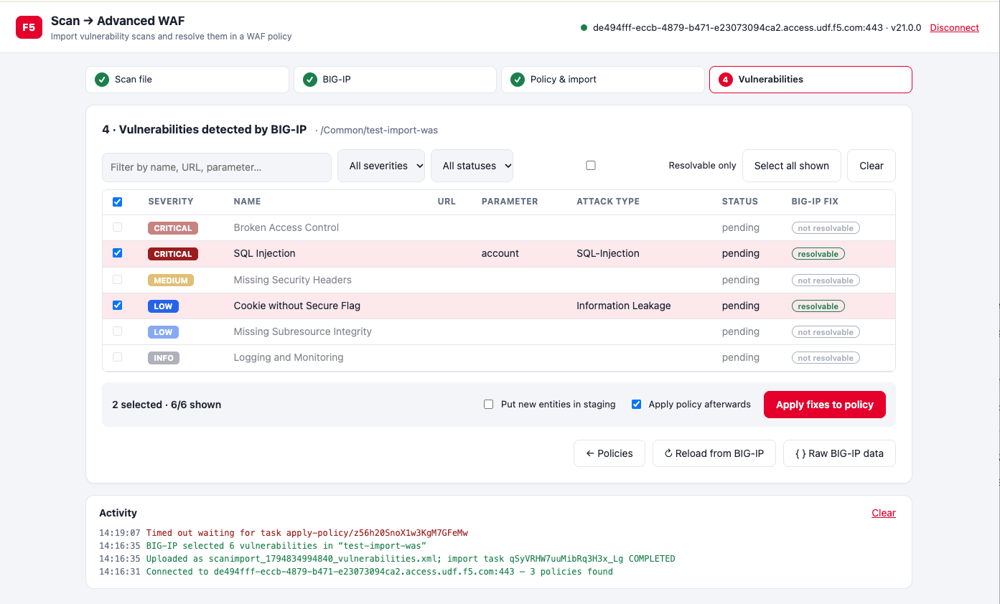

# Scan → BIG-IP Advanced WAF importer

Turn the findings of a vulnerability scanner into WAF protection. This small app (and an equivalent Postman
collection) imports a scanner report into an F5 BIG-IP Advanced WAF policy, shows which vulnerabilities BIG-IP
retained, lets you pick the ones BIG-IP can mitigate, and applies the fixes to the policy.



*Step 4: BIG-IP lists the vulnerabilities derived from the scan; only the ones it can resolve are selectable.*

## Contents
1. [The idea in one minute](#1-the-idea-in-one-minute)
2. [Prerequisites](#2-prerequisites)
3. [Run the app](#3-run-the-app)
4. [Step-by-step walkthrough](#4-step-by-step-walkthrough)
5. [What BIG-IP did with the sample scan](#5-what-big-ip-did-with-the-sample-scan)
6. [What happens on the BIG-IP (REST calls)](#6-what-happens-on-the-big-ip-rest-calls)
7. [Same flow with Postman](#7-same-flow-with-postman)
8. [Troubleshooting](#8-troubleshooting)
9. [Security notes and limits](#9-security-notes-and-limits)

## 1. The idea in one minute

A scanner (DAST) tells you *what is vulnerable*; fixing the application takes time. Advanced WAF can bridge the
gap ("virtual patching"): it reads the scanner report, maps each finding to the WAF protections that mitigate it,
and updates the policy. The workflow has four stages:

| Stage | Goal | Who does the work |
|---|---|---|
| **Import** | Give BIG-IP the scan file for a given policy and domain | App uploads the file, BIG-IP parses it |
| **Review** | See which findings BIG-IP kept and whether each one can be fixed | BIG-IP decides, the app displays |
| **Select** | Choose which *resolvable* findings to act on | You |
| **Resolve & apply** | Let BIG-IP update the policy, then activate it | BIG-IP, triggered by the app |

## 2. Prerequisites

- A BIG-IP with **Advanced WAF (ASM)** provisioned, and at least one WAF policy. The sample run used v21.0.0.
- A user able to manage ASM policies through the REST API (e.g. `admin`), reachable on the management address (HTTPS, port 443 by default).
- A scanner report in the **generic scanner XML format** (see below). Many scanners can export or be converted to it.
- Node.js 18 or later on the laptop. There are no npm dependencies.

## 3. Run the app

    npm start            # http://127.0.0.1:3000
    npm run mock         # optional fake BIG-IP on https://127.0.0.1:8443 (admin/admin) for a dry run
    npm test             # end-to-end test against the mock

The server listens on `127.0.0.1` only (override with `HOST` / `PORT`). The browser talks to this local server, which
talks to the BIG-IP; a browser cannot call the BIG-IP directly because of self-signed certificates and CORS.

## 4. Step-by-step walkthrough

### Step 1 — Choose the scan file
Drop or browse for the XML file on your laptop. The browser parses it locally and shows a preview (severity counts
and a table of findings) so you can check you picked the right file before anything leaves your machine.

Expected format (`vulnerabilities.xml` in this repo is a complete example):

```xml
<scanner_vulnerabilities version="1.0">
  <vulnerability>
    <attack_type>SQL-Injection</attack_type>
    <name>SQL Injection</name>
    <url>http://arcadia-mybank.emea.f5se.com/api/transfers?account=FR76012340010011%27</url>
    <parameter>account</parameter>
    <threat>critical</threat>
    <score>10</score>
    <status>open</status>
  </vulnerability>
</scanner_vulnerabilities>
```

Fields that matter most: `name`, `url` (its host name drives the domain selection in step 3), `parameter` (or
`cookie`), `attack_type`, `threat` and `score`. The more precise the `attack_type` and `parameter`, the better BIG-IP
can map the finding to a protection.

### Step 2 — Connect to the BIG-IP
Enter the management address (add `:port` if not 443), username and password. The app logs in with token
authentication (`/mgmt/shared/authn/login`), checks the credentials, and reads the list of WAF policies. Leave
*Verify TLS certificate* unticked for a self-signed management certificate. Credentials stay in memory only.

### Step 3 — Pick the policy and the domains, then import
1. **Select the WAF policy.** The app lists every policy on the device (name, ID, enforcement mode, attached virtual servers). Use the filter box, or *Rescan policies* to refresh. Pick the policy that protects the application that was scanned.
2. **Choose the domains.** BIG-IP refuses an import unless you say which domain(s) in the scan to use. The app pre-fills the host names found in the scan URLs. You can:
   - keep the ticked domains (default),
   - add a domain by hand (e.g. the name the application is published under),
   - click **Get domains from BIG-IP** to let BIG-IP read the scan and report the domain names it finds, or
   - switch to **All domain names in the scan**.
3. Click **Upload & import scan**. The app uploads the file to the BIG-IP, starts the import task for the selected policy and domains, waits for it to complete, and reads the result back.

### Step 4 — Review, select and resolve
The table shows what **BIG-IP** retained from the scan (not simply what was in the file): severity, name, URL,
parameter, attack type, status, and a **BIG-IP fix** column:

| Badge | Meaning |
|---|---|
| `resolvable` (green) | BIG-IP can mitigate this finding in the policy. Selectable. |
| `not resolvable` (grey) | BIG-IP has no automatic mitigation (`resolveType: not-resolvable`). Greyed out and **cannot be selected**; sending it would make BIG-IP reject the whole request. |
| `resolved` | Already resolved in an earlier run. Not selectable. |

To apply fixes:
1. Narrow the list with the filters (text, severity, status) or tick **Resolvable only** to hide the greyed rows.
2. Tick the vulnerabilities to fix, or use **Select all shown** (it only ever selects resolvable ones).
3. Choose the options:
   - **Put new entities in staging**: newly created policy entities are staged rather than enforced immediately. Sensible on production traffic.
   - **Apply policy afterwards** (on by default): activates the policy after the fixes. Untick it if you want to review the changes in the BIG-IP GUI first and apply manually.
4. Click **Apply fixes to policy** and confirm. The Activity log at the bottom records every step; the list refreshes and resolved items change status.

The exact policy changes depend on the vulnerability type, so review the policy on the BIG-IP after resolving.
*Raw BIG-IP data* shows the unmodified objects returned by the device, which is useful for troubleshooting or for
documenting what BIG-IP actually returned.

## 5. What BIG-IP did with the sample scan

`vulnerabilities.xml` contains 12 findings. On the lab BIG-IP, importing it into a test policy gave **6
vulnerabilities**, of which **2 were resolvable** (see the screenshot above):

| Finding | Severity | BIG-IP attack type | Resolvable? |
|---|---|---|---|
| SQL Injection (parameter `account`) | critical | SQL-Injection | Yes |
| Cookie without Secure Flag | low | Information Leakage | Yes |
| Broken Access Control | critical | — | No |
| Missing Security Headers | medium | — | No |
| Missing Subresource Integrity | low | — | No |
| Logging and Monitoring | info | — | No |

Two things to take away for the article: BIG-IP does not keep every finding (here "Missing Security
Headers" appears once although the scan lists it four times, and the "Vulnerable Server Software" and "Insecure
Transport Layer" findings are absent), and
only findings that map to a WAF protection (injection attacks, cookie attributes) are resolvable. Business-logic
and configuration issues still need an application or infrastructure fix.

## 6. What happens on the BIG-IP (REST calls)

| UI action | iControl REST call |
|---|---|
| Connect | `POST /mgmt/shared/authn/login` (token) |
| List policies | `GET /mgmt/tm/asm/policies` |
| Upload scan | `POST /mgmt/tm/asm/file-transfer/uploads/<file>` (chunked with `Content-Range`) |
| Get domains | `POST /mgmt/tm/asm/tasks/import-vulnerabilities` with `onlyGetDomainNames: true` |
| Import | `POST /mgmt/tm/asm/tasks/import-vulnerabilities` with `domainNames` or `importAllDomainNames` |
| Review | `GET /mgmt/tm/asm/policies/<id>/vulnerabilities` (+ `/mgmt/tm/asm/attack-types` to name attack types) |
| Resolve | `POST /mgmt/tm/asm/tasks/resolve-vulnerabilities` with the selected vulnerability references |
| Apply | `POST /mgmt/tm/asm/tasks/apply-policy` |

Import, resolve and apply are asynchronous **tasks**: the POST returns a task ID, and the app polls
`GET /mgmt/tm/asm/tasks/<kind>/<id>` until the status is `COMPLETED` (or reports the failure).
Payload field names live in `server.js` (`routes`); check them against your BIG-IP version's iControl REST docs.

## 7. Same flow with Postman

`postman/` contains a collection and an environment that call the REST API directly:
login → pick policy by name → upload scan → (discover domains) → import → list vulnerabilities →
resolve → apply policy → verify → logout.

1. Import both files into Postman.
2. Fill in the environment: `bigip_host`, `bigip_password`, `policy_name`, and `domain_names` (or `import_all_domains=true`).
3. Run the collection with the Collection Runner; polling requests re-run themselves until the task is `COMPLETED`.
4. Leave `vulnerability_ids` empty to resolve every resolvable, still-open vulnerability, or list specific IDs (printed in the Console by request 3.1). Not-resolvable items are never sent.

The scan XML is embedded in request 2.1 (regenerate with `node postman/generate.js`, which reads `vulnerabilities.xml`).
Verified with Newman against the mock:

    npx newman run postman/*collection.json -e postman/*environment.json --env-var bigip_host=127.0.0.1:8443 --env-var bigip_password=admin --insecure

## 8. Troubleshooting

| Symptom / BIG-IP message | Cause and fix |
|---|---|
| `Must have at least 1 of (onlyGetDomainNames, importAllDomainNames, domainNames)` | The import needs a domain choice. Tick at least one domain or choose "All domain names" (step 3). |
| `Can not resolve Vulnerabilities with resolveType 'not-resolvable'` | A not-resolvable item was included in the request. The app now blocks these; in Postman, remove them from `vulnerability_ids`. |
| Attack type column empty | BIG-IP returns attack types as references. The app resolves them through `/mgmt/tm/asm/attack-types`; if still empty, open *Raw BIG-IP data* to check the field names. |
| `Authentication failed` | Wrong credentials, or the account cannot use the REST API. |
| `Cannot reach host:port` | Management address or port wrong, or not reachable from the laptop. |
| `Timed out waiting for task apply-policy/…` | The app waits up to 120 s for a task. Applying a large policy can take longer. Check the policy status on the BIG-IP; the apply may still complete. |
| URL column empty | The device returned the URL in a field the app does not read yet. Open *Raw BIG-IP data* to find the field name. |
| Browser shows "session expired" | Idle for 30 minutes; reconnect in step 2. |

## 9. Security notes and limits

- Binds to `127.0.0.1`, keeps credentials in memory only (30 min idle), and refuses cross-origin API calls. Do not expose it on a network without adding TLS and authentication.
- Resolving and applying **modify a live WAF policy**: try it on a lab or non-production policy first, and use staging.
- The app was developed against a mock BIG-IP and exercised on a v21.0.0 lab device for connect, policy listing, import and vulnerability listing. The resolve/apply payloads and the long-running apply should be validated on your version before production use. In particular, the *Put new entities in staging* option sends a `stage` flag whose name has not been confirmed against the BIG-IP API, so verify in the policy that entities were actually staged.
